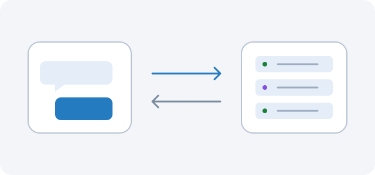

**GitHub MCP** 把 GitHub 官方远程 MCP 服务器接入 DeepSeek Harness,让助手用你的 GitHub 账号完成日常开发工作:

- 搜索仓库、代码、用户
- 创建、评论、管理 Issue(提问题)
- 浏览与评审 Pull Request
- 读取仓库文件、提交、Release 与标签

共 46 个工具,命名与 Claude Code 一致(`mcp__github__<tool>`)。安装后需要先在凭据存储中保存 `GITHUB_PAT`(GitHub Personal Access Token),详见插件详情页或仓库 README。在对话里直接说「帮我看一下 `owner/repo` 的 open issue」即可开始使用。安装即生效,**无需重启** DeepSeek Harness;更换 `GITHUB_PAT` 凭据后也立即生效。
